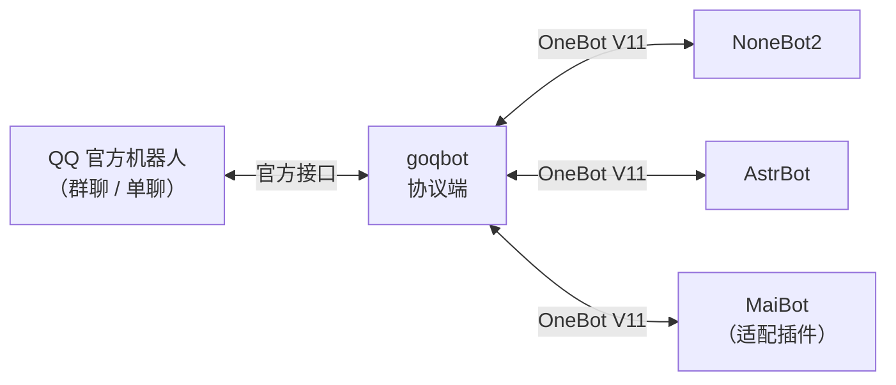
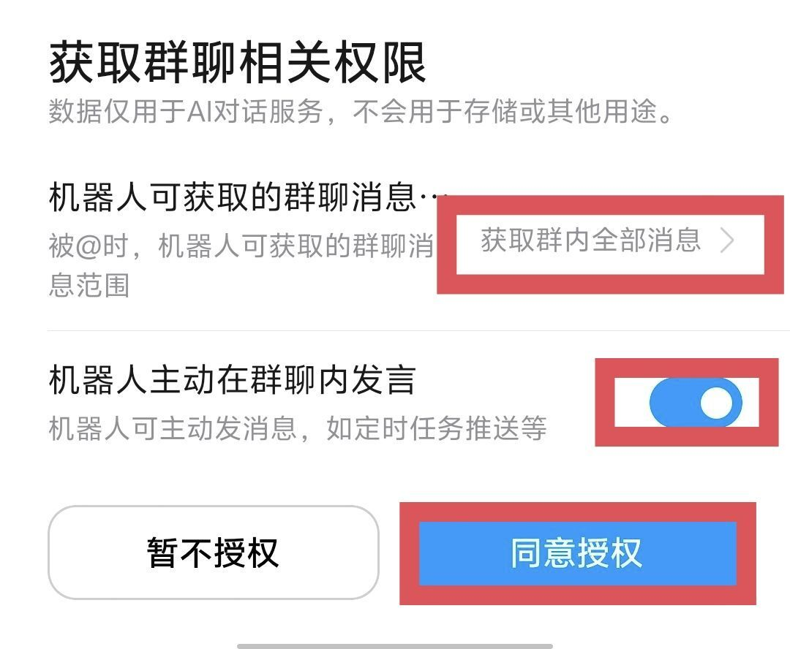

<div align="center">

# goqbot

**把 QQ 官方机器人接进 NoneBot2、AstrBot、MaiBot<br>一个协议端，同时服务多个机器人框架**

<a href="https://go.dev/"></a>
<a href="https://github.com/botuniverse/onebot-11"></a>

<a href="https://huilongxiji.github.io/gd-goqbot-docs/"></a>
<a href="LICENSE"></a>
<a href="https://github.com/huilongxiji/gd-goqbot-framework/stargazers"></a>

<a href="https://huilongxiji.github.io/gd-goqbot-docs/">📖 文档</a> ｜
<a href="#-快速开始">🚀 快速开始</a> ｜
<a href="https://huilongxiji.github.io/gd-goqbot-docs/guide/multi-framework">🧩 框架接入</a> ｜
<a href="https://huilongxiji.github.io/gd-goqbot-docs/api/overview">📚 API</a> ｜
<a href="https://github.com/huilongxiji/gd-goqbot-framework/releases">📦 下载</a> ｜
<a href="https://github.com/huilongxiji/gd-goqbot-framework/issues">🐛 问题反馈</a>

</div>

---

QQ 官方机器人只能通过腾讯自己的接口开发，OneBot 生态里现成的框架和插件没法直接用。

**goqbot 就是中间的翻译层**：它登录你的 QQ 官方机器人，把收到的群聊、单聊消息转成标准的 **OneBot V11** 事件推给你的机器人框架，再把框架的回复翻译成官方接口发出去。你的 NoneBot2 / AstrBot 插件不需要为 QQ 官方单独适配；而且**一个 goqbot 可以同时连多个框架**，共用同一个官方机器人。



## ✨ 为什么用 goqbot

1. 📦 **开箱即用**：单个可执行文件加一份 `config.yml`，不用装任何运行环境；首次运行自动生成配置。Windows / Linux / macOS 都能跑，x64 和 ARM64（含树莓派）都有现成的包。
2. 🔀 **一个协议端，多个框架**：NoneBot2、AstrBot、MaiBot 可以同时接入。每条消息都会发给所有框架，由各个框架自己决定回不回复。
3. 🔌 **标准 OneBot V11**：支持正向 / 反向 WebSocket，消息段写法和 go-cqhttp 生态一致，已有插件基本不用改。
4. 💬 **QQ 官方特色能力**：Markdown + 按钮（含点击回调）、图文卡片、单聊流式消息（打字机效果）、素材管理、自定义菜单与指令面板。
5. 🖼️ **富媒体省心**：图片、视频、语音、文件都能收发；发送时直接给 URL、本地路径或 base64，不用自建图床，大文件自动分片上传。
6. 🧠 **自动选择被动 / 主动消息**：优先使用免费的被动回复额度，过期了再改发主动消息；也可以用 `passive_only` 精确控制主动消息额度。
7. 💾 **重启不丢 ID**：用户、群、消息的 ID 映射会持久化保存，重启后仍然可以撤回消息、反查用户。
8. 🪶 **适合长期挂机**：Go 单进程，各类缓存都有上限和自动清理；日志在终端按颜色分级显示，同时按天写入文件。

## 🧩 支持的框架

| 框架 | 接入方式 | 教程 |
|---|---|---|
| [NoneBot2](https://github.com/nonebot/nonebot2) | 自带的 OneBot V11 适配器，正向 / 反向 WS 都可以 | [NoneBot2 接入](https://huilongxiji.github.io/gd-goqbot-docs/guide/nonebot) |
| [AstrBot](https://github.com/AstrBotDevs/AstrBot) | 在 WebUI 里添加「OneBot v11」平台（反向 WS） | [AstrBot 接入](https://huilongxiji.github.io/gd-goqbot-docs/guide/astrbot) |
| [MaiBot](https://github.com/Mai-with-u/MaiBot) | 安装 [MaiBot-GoqBot-Adapter](https://github.com/huilongxiji/MaiBot-GoqBot-Adapter) 插件 | [MaiBot 接入](https://huilongxiji.github.io/gd-goqbot-docs/guide/maibot) |
| 其他 OneBot V11 框架 | 正向 / 反向 WebSocket | [接入概览](https://huilongxiji.github.io/gd-goqbot-docs/guide/multi-framework) |

> 文本、@、图片、引用等标准消息段在所有框架里都能用。Markdown、按钮、流式、图文卡片这些 QQ 特有的消息段，写法以 **NoneBot2** 为准。

## 🚀 快速开始

**准备工作**：在 [QQ 开放平台](https://q.qq.com/qqbot) 创建机器人，拿到 **AppID** 和 **AppSecret**，并把运行 goqbot 的机器的公网 IP 加进开放平台的 IP 白名单。

**1. 下载**：到 [Releases](https://github.com/huilongxiji/gd-goqbot-framework/releases) 下载对应平台的文件。

| 平台 | 文件 |
|---|---|
| Linux x86_64 | `goqbot-linux-amd64` |
| Linux ARM64（树莓派等） | `goqbot-linux-arm64` |
| Windows x64 / ARM64 | `goqbot-windows-amd64.exe` / `goqbot-windows-arm64.exe` |
| macOS Intel / Apple Silicon | `goqbot-darwin-amd64` / `goqbot-darwin-arm64` |

**2. 首次运行**：把文件放进一个空目录后运行，同目录会自动生成 `config.yml`。

```bash
chmod +x goqbot-*      # Linux / macOS 需要先加执行权限
./goqbot-linux-amd64   # 换成你下载的文件名
```

**3. 填写配置**：打开 `config.yml`，至少填好下面几项（以反向连接 NoneBot2 为例）。

```yaml
qq:
  app_id: "你的 AppID"
  client_secret: "你的 AppSecret"
  mention_mode: at          # 让框架能识别「@机器人」，多框架时推荐

onebot:
  access_token: ""          # 建议设置，框架那边填同一个值
  servers:
    - ws-reverse:
        universal: ws://127.0.0.1:8080/onebot/v11/ws   # NoneBot2 默认地址
```

**4. 再次启动**：看到 `goqbot x.y.z 已启动，等待连接...` 就说明成功了。框架那边怎么设置，请看上面 [支持的框架](#-支持的框架) 里对应的教程。

所有配置项的说明见 [配置说明](https://huilongxiji.github.io/gd-goqbot-docs/guide/config)，模板见 [`config.example.yml`](config.example.yml)。

<details>
<summary>从源码编译</summary>

需要 Go 1.26+，编译产物是一个静态二进制：

```bash
git clone https://github.com/huilongxiji/gd-goqbot-framework.git
cd gd-goqbot-framework
CGO_ENABLED=0 go build -trimpath -ldflags "-s -w" -o goqbot .
```

</details>

## 📦 功能一览

| 功能 | 群聊 | 单聊 | 说明 |
|---|:---:|:---:|---|
| 文本 / @ / 引用回复 | ✅ | ✅ | 自动使用被动回复凭证 |
| 图片 / 视频 / 语音 / 文件 | ✅ | ✅ | 收发双向；URL、本地路径、base64 都能直接发 |
| Markdown + 按钮 | ✅ | ✅ | 按钮点击回调闭环，可唤起手机相册 |
| 图文卡片 | ✅ | ✅ | `share` / `card` 段 |
| 流式消息 | — | ✅ | 打字机式逐字输出 |
| 主动消息 / 互动召回 | ✅ | ✅ | 主动推送；单聊支持 `is_wakeup` 召回 |
| 撤回 / 取回消息 | ✅ | ✅ | `delete_msg` / `get_msg` / `get_forward_msg` |
| 群内全部消息 | ✅ | — | 需要群主授权，见下方常见问题 |
| 群管理 | ✅ | — | 群信息、成员列表、禁言、入群审批 |
| 通知事件 | ✅ | ✅ | 入退群、好友增删、主动推送开关、入群申请 |
| 菜单 / 指令面板 / 素材 | 全局 | 全局 | 自定义菜单、指令面板、素材图片管理 |

<details>
<summary>全部 OneBot 动作</summary>

| 分类 | 动作 |
|---|---|
| 基础信息 | `get_login_info` · `get_status` · `get_version_info` · `get_gateway` · `get_openid` · `get_c2c_msg_state` |
| 发送消息 | `send_msg` · `send_group_msg` · `send_private_msg` · `send_group_active_msg` · `send_private_active_msg` |
| 消息管理 | `delete_msg` · `get_msg` · `get_forward_msg` · `put_interaction` |
| 群聊管理 | `get_group_info` · `get_group_bot_state` · `get_group_member_list` · `get_group_member_info` · `get_group_join_requests` · `set_group_add_request` · `set_group_ban` · `get_group_ban` |
| 菜单与面板 | `get_menu` · `set_menu` · `get_command_panels` · `get_command_panel` · `create_command_panel` · `set_command_panel` · `delete_command_panel` · `set_command_panel_target` |
| 素材管理 | `upload_media_image` · `get_media_image` · `get_media_images` · `delete_media_image` |

参数和返回值见 [API 文档](https://huilongxiji.github.io/gd-goqbot-docs/api/overview)；消息段写法见 [消息段](https://huilongxiji.github.io/gd-goqbot-docs/protocol/segments)；能收到哪些事件见 [入站事件](https://huilongxiji.github.io/gd-goqbot-docs/protocol/events)。

</details>

## 💡 使用示例（NoneBot2）

```python
# 普通回复：自动使用被动回复凭证，不消耗主动消息额度
await matcher.send("收到")

# 主动推送：不依赖用户先发消息，受官方频率限制
await bot.call_api("send_group_active_msg", group_id=123456, message="公告：今晚维护")

# 发图片：URL / 本地路径 / base64 都可以
await matcher.send(MessageSegment.image("https://example.com/cat.png"))
```

更多写法（Markdown 按钮、流式消息、素材引用等）见 [NoneBot2 接入](https://huilongxiji.github.io/gd-goqbot-docs/guide/nonebot)。仓库里的 [`nb_plugins_demo/goqbot_test`](nb_plugins_demo/goqbot_test) 是一个覆盖全部功能的 NoneBot2 测试插件，可以直接拿来对照。

## ❓ 常见问题

<details>
<summary><b>机器人只能收到 @ 它的消息，怎么收到群里所有消息？</b></summary>

需要**群主**在手机 QQ 上授权一次：把「机器人可获取的群聊消息范围」设为 **获取群内全部消息**，开启 **机器人主动在群聊内发言**，然后点 **同意授权**。

<p align="center"></p>

授权后，在 `config.yml` 的 `qq.text_intent` 里加上 `GroupMessageEventHandler`。

> QQ 弹出的快捷授权链接目前实测只有安卓手机 QQ 能打开；授权开关本身在其他客户端也能设置。

</details>

<details>
<summary><b>用户 @ 了机器人，框架却识别不到「被 @」？</b></summary>

默认的 `qq.mention_mode: strip` 会把 @ 机器人的那一段删掉。改成 `mention_mode: at`，NoneBot 的 `to_me()`、AstrBot 的 @ 唤醒、MaiBot 的「被提及」就都能识别了。

</details>

<details>
<summary><b>日志里出现 11298 错误？</b></summary>

说明本机公网 IP 不在 QQ 开放平台的 IP 白名单里。加进去之后，goqbot 会按 `qq.ip_reject_action`（`stop` / `retry` / `exit`）的设置恢复，见 [配置说明](https://huilongxiji.github.io/gd-goqbot-docs/guide/config)。

</details>

<details>
<summary><b>框架里看到的 user_id / group_id 不是真实 QQ 号？</b></summary>

QQ 官方机器人拿不到真实 QQ 号和群号，只有 openid。goqbot 会把 openid 稳定地映射成数字 ID，在所有框架里都一样，但不等于真实号码；同一个人在群聊和私聊里的 ID 也不同。

</details>

<details>
<summary><b>主动消息发不出去？</b></summary>

群聊主动消息需要群主开启「机器人在群聊内发言」，而且受官方频率限制（每个群每天最多 1000 条等）。用户或群主关闭主动推送后，主动消息也会失败。详见 [已知限制](https://huilongxiji.github.io/gd-goqbot-docs/guide/limits)。

</details>

## ⚠️ 项目定位与已知限制

- 这是开发者**自用并长期维护**的项目，开源出来供学习与交流；功能按开发者自己的使用习惯取舍，不保证覆盖所有框架的所有用法。
- 上游只支持 QQ 官方 **WebSocket**，暂不支持 Webhook；下游只支持 OneBot V11 **正向 / 反向 WebSocket**，不支持 HTTP。
- 目前只覆盖 **QQ 群和单聊**；频道（guild）暂未接入。

完整说明见 [已知限制](https://huilongxiji.github.io/gd-goqbot-docs/guide/limits)。

## 🔗 相关项目

- [gd-goqbot-docs](https://github.com/huilongxiji/gd-goqbot-docs)：本项目的文档站源码
- [MaiBot-GoqBot-Adapter](https://github.com/huilongxiji/MaiBot-GoqBot-Adapter)：让 MaiBot 接入 goqbot 的插件

## 🙏 致谢

- [tencent-connect/botgo](https://github.com/tencent-connect/botgo)：QQ 官方机器人 Go SDK（本项目内化使用）
- [Mrs4s/go-cqhttp](https://github.com/Mrs4s/go-cqhttp)：OneBot 实现思路参考
- [Hoshinonyaruko/Gensokyo](https://github.com/Hoshinonyaruko/Gensokyo)：QQ 官方机器人 ↔ OneBot 适配的先行项目
- [nonebot/nonebot2](https://github.com/nonebot/nonebot2)：下游机器人框架

## 📄 许可证

本项目以 [GNU AGPL-3.0](LICENSE) 开源。
