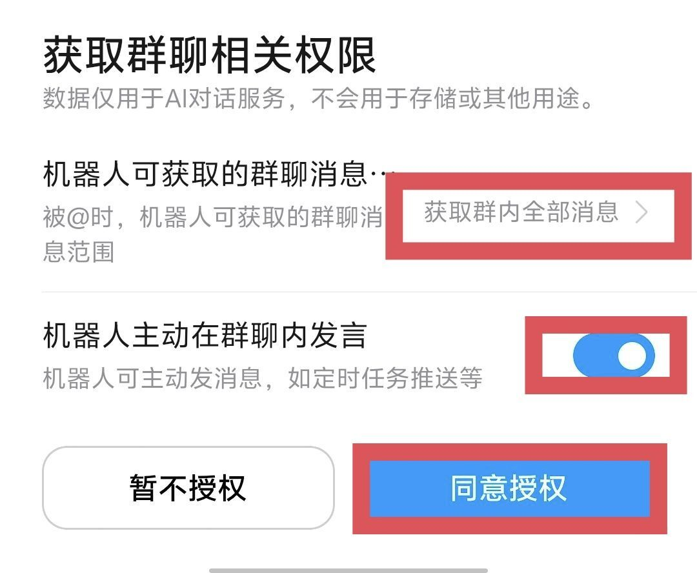
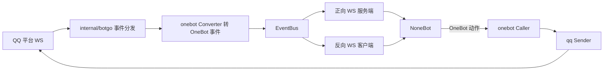

# goqbot

<p align="center">
  一个由 Go 编写的 <b>QQ 官方机器人 ↔ OneBot V11</b> 适配器，让 QQ 官方机器人（群 / 单聊）无缝接入 NoneBot 等 OneBot V11 生态。
</p>

<p align="center">
  
  
  
  <a href="https://huilongxiji.github.io/gd-goqbot-docs/"></a>
  
</p>

---

## 简介

`goqbot` 把 **QQ 官方机器人**（基于内化的 [botgo](https://github.com/tencent-connect/botgo)）的上游事件转换为 **OneBot V11** 事件，通过正向 / 反向 WebSocket 对接下游框架；并把下游下发的 OneBot 动作翻译为 QQ 官方接口调用。思路参考 [go-cqhttp](https://github.com/Mrs4s/go-cqhttp) 与 [Gensokyo](https://github.com/Hoshinonyaruko/Gensokyo)，目标是 QQ 群 / 单聊维度的双向打通。

- **自包含单文件**：botgo 已内化进 `internal/botgo`，`go.mod` 无 `replace`、无外部 botgo 依赖；Go 静态编译为**单个二进制**，运行只需 `goqbot` + `config.yml`。
- **双连接形态**：既可作正向 WS 服务端等 NoneBot 连入，也可作反向 WS 客户端主动连 NoneBot 的 OneBot V11 适配器。
- **被动 / 主动消息**：自动选择 `msg_id` / `event_id` 被动凭证（免费、窗口内），也支持强制主动推送。
- **持久化 ID 映射**：openid ↔ 数字 id、message_id 基于 bbolt 持久化，重启后仍可撤回 / 反查。

**使用文档**：独立文档站仓库 [`gd-goqbot-docs`](https://github.com/huilongxiji/gd-goqbot-docs)（发布后为 https://huilongxiji.github.io/gd-goqbot-docs/ ）。

---

## 项目定位与声明

> 请在使用前阅读，避免预期落差。

- 本项目**本质上是开发者的个人自用程序**，开源出来**仅供学习与交流用途**。
- 它会**长期维护**，但完全按照**开发者本人的使用习惯**来设计与取舍功能。
- **从立项之初就没有打算做成一个面向所有框架的通用适配器**，不追求「彻底多框架通用」。
- 核心目标是**服务于 NoneBot2（nb2）的消息段（message segment）写法**。若你的用法与此不同，可能需要自行改造，恕不保证适配，也不一定接受相关需求。

---

## 连接方式与限制

当前版本的连接能力边界如下：

- **上游（连接腾讯 QQ 官方）**：仅支持 **WebSocket**，**暂不支持 Webhook** 回调方式。
- **下游（连接 NoneBot2）**：仅支持**正向 / 反向 WebSocket**，**不支持正向 / 反向 HTTP**。

---

## 已支持功能

- QQ **群 @ 消息**（`GROUP_AT_MESSAGE_CREATE`）与**单聊 C2C 消息**（`C2C_MESSAGE_CREATE`）双向收发
- 群全量消息（需群主授权"获取群内全部消息"，`GROUP_MESSAGE_CREATE`）；`mention_mode: at` 时把 `@机器人` 转成 OneBot at 段，NoneBot `to_me()` 为真。授权步骤见 [群全量消息授权](#群全量消息授权)
- **"最近十条"摘要解析**：群设为"最近十条"时，QQ 在 @ 事件（`message_type=103`）随附的历史消息摘要会被解析为结构化 `recent_messages` 数组（含内容与发送者昵称）
- **原始 QQ 事件字段透传**：群消息事件附带 `qq_message_type`、`msg_elements`、`msg_scene_ext`、`qq_msg_id`、`user_openid` 等原始字段，便于下游精细处理
- **群成员真实角色**：群消息 `sender.role` 透传真实 `owner` / `admin` / `member`，可直接配合 NoneBot `GROUP_OWNER` / `GROUP_ADMIN` 权限
- **`union_openid` 跨 AppID 关联标识**：群 / 单聊消息在 QQ 下发时（需向平台申请配置）透传到事件级 `union_openid` 与 `sender.union_openid`，存在才写入
- **单聊互动召回消息（`is_wakeup`）**：用户主动对话后 30 天内分 4 个周期每周期可下发 1 条（详见动作表）
- **富媒体收发（图片 / 视频 / 语音 / 文件）**：群 / 单聊均支持**双向**收发；发送支持 `http(s)://` / `file://` / 本地绝对路径 / `base64://`，无需自建图床；**本地大文件（>10MB）自动走分片上传**
- **单聊流式消息**：C2C 支持 `stream` 段分帧下发，实现打字机式实时输出（首帧建流并返回 `stream_id`，续帧串联，末帧收尾）
- **单图文合一气泡**：一条消息恰含 1 张图片且无 markdown 时，文本自动并入该图片的富媒体消息，合并为一个气泡（文字在上、图在下），对齐手机 QQ 的图文混排观感
- **Markdown + Keyboard（按钮）**：模板 / 原生 markdown + 自定义按钮；指令按钮 `action.anchor=1` 可**唤起手机端相册选图器**。群/单聊发送固定带 `force_verify_image_resource=true`：正文图片转存失败则消息不发出，下游收到失败
- **互动按钮回调**闭环：点击事件上报 + 自动被动 `event_id` 回复 + `put_interaction` 回执
- **合并转发取回**：入站合并转发（"最近十条" / 全量聊天记录）解析为节点数组并缓存，下游用 `get_forward_msg` 取回
- 入退群、好友增删、群 / C2C 主动推送开关等 **notice** 事件
- 消息**撤回**（`delete_msg`）、消息**取回**（`get_msg`，内存缓存）
- 正向 / 反向 WS，`access_token` 鉴权，lifecycle / heartbeat 元事件
- 反向连接**失败缓存重发**，断线自动重连
- **全下游掉线兜底**：所有下游断开时可回发 QQ 一段兜底文本
- `array`（消息段数组）与 `string`（CQ 码）两种上报格式
- `/gateway/bot` 网关频控查询（启动日志 + `get_gateway` 动作）
- **分级日志与美化排版**：`[Info]` / `[Warning]` / `[Error]` 统一级别；收 / 发 / 通知渲染为边框块；终端按级别 / 语义上色（错误红、警告黄，仅 TTY），重定向到文件时自动去色
- **本地文件日志**：默认可执行文件同级 `logs/goqbot-YYYY-MM-DD.log` 按天滚动；单行统一为 `[Level] 时间 [来源] 消息`，文件恒为纯文本

---

## 支持的 OneBot 动作（API）

下游通过 OneBot V11 动作请求调用（`action` 自动去除 `_async` 后缀，回填 `echo`）。

| action | 主要参数 | 说明 |
|---|---|---|
| `get_login_info` | - | 返回 `user_id`(self_id) 与机器人 `nickname`（READY 后为真实昵称，未就绪回退 app_id） |
| `get_status` | - | `{ online: true, good: true }` |
| `get_version_info` | - | 程序名 / 版本 / 协议版本 |
| `send_group_msg` | `group_id`, `message`, (`user_id`) | 发群消息（被动优先） |
| `send_private_msg` | `user_id`, `message`, (`is_wakeup`) | 发单聊消息（被动优先）；`is_wakeup=true` 走互动召回；带 `stream` 段则**流式发送**并额外返回 `stream_id` |
| `send_msg` | `message_type` / 自动判定 + 对应 id + `message` | 按类型分派到群 / 私聊 |
| `send_group_active_msg` | `group_id`, `message` | **强制主动**发群（忽略 reply / lazy 凭证） |
| `send_private_active_msg` | `user_id`, `message` | **强制主动**发单聊 |
| `delete_msg` | `message_id` | 撤回（按 message_id 反查 QQ 原始 msg_id） |
| `get_msg` | `message_id` | 取回消息快照（入站 + 发出，仅内存） |
| `get_forward_msg` | `id` / `message_id` | 取回合并转发的节点数组（入站解析后缓存，FIFO 有界） |
| `get_openid` | `user_id` / `group_id` | 把数字 id 反查回 QQ 原始 openid |
| `put_interaction` / `send_interaction_ack` | `interaction_id`, `code`(默认 0) | 互动按钮回执 |
| `get_gateway`（别名 `get_gateway_bot` / `get_session_limit`） | - | 查询 WS 接入点与剩余可建连次数等频控信息 |
| `get_group_info` | `group_id` | 获取群基本信息（官方白名单，非白名单返回 11253） |
| `get_group_bot_state` | `group_id` | 获取机器人群内状态（白名单） |
| `get_group_member_list` | `group_id`, (`cursor`) | 获取群成员列表（白名单；每次最多 30 条，`next_cursor` 分页） |
| `get_group_member_info` | `group_id`, `user_id` | `user_id=self_id` 走 bot_state；查他人走官方成员接口（须能反查 openid） |
| `get_group_join_requests`（别名 `get_group_system_msg`） | `group_id`, (`cursor`/`limit`) | 拉取入群申请列表（需群管理员） |
| `set_group_add_request` | `flag`, `approve`, (`reason`/`blacklist`) | 审批入群申请；`flag`=官方 `join_request_id`（需群管理员） |
| `set_group_ban` | `group_id`, `user_id`, `duration` | 成员禁言（秒；0=解除；需群管理员） |
| `get_group_ban`（别名 `get_group_mute`） | `group_id` | 查询群禁言状态（需群管理员） |
| `set_group_whole_ban` | - | **不支持**（官方设置接口仅成员级，返回 1404） |
| `get_c2c_msg_state`（别名 `get_friend_msg_state`） | `user_id` / `user_openid` | 查询用户 C2C 主动消息推送开关（**非官方接口**，基于本地事件缓存） |
| `get_menu` / `set_menu` | `menu.items` | 查询 / 整体覆盖全局自定义菜单（仅单聊底部；`set_menu` 约 5 QPM） |
| `get_command_panels` / `get_command_panel` | `scope` / `panel_id` | 查询指令面板列表 / 详情 |
| `create_command_panel` / `set_command_panel` / `delete_command_panel` | `scope`,`panel` / `panel_id` | 创建 / 覆盖 / 删除指令面板 |
| `set_command_panel_target` | `panel_id`,`op`,`user_openids`/`group_openids` | 修改 specific 面板的关联对象 |

> 未识别的 action 返回 `status=failed`、`retcode=1404`（`message: unsupported action: xxx`），符合 OneBot v11 规范；已实现的动作按 QQ 实际调用结果透传成功/失败码。
>
> **互动召回（`is_wakeup=true`）**：用户主动对话后 30 天内分 4 个周期（当天 / 1-3 天 / 3-7 天 / 7-30 天）每周期可下发 1 条，仅 C2C，与 reply / 被动 `event_id` 互斥。
>
> **群聊管理权限**：`info` / `bot_state` / `get_group_member_list` / 查他人的 `get_group_member_info` 为白名单接口（内邀，非白名单返回 11253）；入群申请列表/审批、禁言查询/设置需机器人具备群管理员身份。权限不足时透传 QQ 原始错误，不做假成功。
>
> **C2C 推送状态**：官方无查询接口。需启用 `C2CMsgRejectEventHandler` / `C2CMsgReceiveEventHandler`，框架将开关事件落库到 idmap；`get_c2c_msg_state` 读缓存。从未手动操作过开关的用户返回 `known=false`。
>
> 每个动作的完整参数表与成功/失败 JSON 见 [文档 · API 动作总览](https://huilongxiji.github.io/gd-goqbot-docs/api/overview)。

### 消息段支持（`parseMessage`）

| 段类型 | 收（QQ → OneBot） | 发（OneBot → QQ） |
|---|---|---|
| `text` | ✅ | ✅ |
| `at` | ✅（`mentions.is_you` → at self） | ✅（转 `<@openid>`，at self/all 跳过） |
| `image` | ✅（go-cqhttp 风格 `file=<md5>.image`） | ✅（base64 / url / 本地文件直传） |
| `video` | ✅ | ✅（简单上传 / 大文件分片） |
| `record` / `voice` / `audio`（语音） | ✅ | ✅（简单上传 / 大文件分片） |
| `file` | ✅（带 `name` / `file_size`） | ✅（可带 `name`；大文件分片） |
| `markdown` + `keyboard` | —— | ✅（模板 / 原生 markdown，按钮 keyboard，支持 `anchor` 唤起相册；可与 `reply` 同发引用） |
| `stream` | —— | ✅（**仅 C2C**，流式分帧；见下方说明） |
| `reply` | —— | ✅（取被引用消息作被动凭证 + REFIDX 引用索引） |

- 入参支持 **array 段数组** 与 **CQ 字符串** 两种格式。
- 输出为有序 `OutMessage.Parts`，**每个非文本段单独成一条 QQ 消息按序发出**（连续文本 / at 合并）。
- **单图快路径**：当整条消息恰好为「文本 + 1 张图片」（无 markdown）时，所有文本并入该图片富媒体消息，合并成**一个气泡**，而非拆成图、文两条。
- **富媒体来源**：`base64://` / `http(s)://` / `file://` / 本地绝对路径；本地文件 >10MB 自动切换分片上传，`file` / `video` 建议带含扩展名的 `name`（视频分片会自动补 `.mp4`）。

> **流式消息（`stream` 段，仅 C2C）**：携带 `{state, id, index, reset}`。`state`：1 生成中 / 10 结束 / 11 引导生成中 / 20 引导结束。**首帧** `index=0` 且不带 `id`，发送成功后响应额外返回 `stream_id`；**续帧**把 `stream_id` 回填到 `id`、`index` 逐帧递增；**末帧** `state=10`。`index>=1` 缺 `id` 会被平台判为无效续帧；群聊会忽略 `stream` 并告警。

---

## 入站事件支持矩阵

| QQ 事件 | 中文名称 | OneBot 上报 | handler 名 |
|---|---|---|---|
| GROUP_AT_MESSAGE_CREATE | 群内 @ 机器人消息 | `message/group` | `GroupATMessageEventHandler` |
| GROUP_MESSAGE_CREATE | 群内全部消息（需群主开启） | `message/group` | `GroupMessageEventHandler` |
| C2C_MESSAGE_CREATE | 单聊(C2C)消息 | `message/private` | `C2CMessageEventHandler` |
| GROUP_ADD_ROBOT | 机器人被加入群 | `notice/group_increase` | `GroupAddRobotEventHandler` |
| GROUP_DEL_ROBOT | 机器人被移出群 | `notice/group_decrease` | `GroupDelRobotEventHandler` |
| GROUP_MSG_REJECT | 群关闭主动消息推送 | `notice/group_msg_reject`（自定义） | `GroupMsgRejectEventHandler` |
| GROUP_MSG_RECEIVE | 群开启主动消息推送 | `notice/group_msg_receive`（自定义） | `GroupMsgReceiveEventHandler` |
| GROUP_JOIN_REQUEST | 用户申请加群 | `request/group`（`flag`=`join_request_id`） | `GroupJoinRequestEventHandler`（需群管理员） |
| GROUP_MEMBER_ADD | 群成员加入 | `notice/group_increase` | `GroupMemberEventHandler` |
| GROUP_MEMBER_REMOVE | 群成员退出 | `notice/group_decrease` | `GroupMemberEventHandler` |
| FRIEND_ADD | 用户添加机器人好友 | `notice/friend_add` | `C2CFriendEventHandler` |
| FRIEND_DEL | 用户删除机器人好友 | `notice/friend_decrease`（自定义） | `C2CFriendEventHandler` |
| C2C_MSG_REJECT | 用户关闭单聊主动消息 | `notice/c2c_msg_reject`（自定义） | `C2CMsgRejectEventHandler` |
| C2C_MSG_RECEIVE | 用户开启单聊主动消息 | `notice/c2c_msg_receive`（自定义） | `C2CMsgReceiveEventHandler` |
| INTERACTION_CREATE | 按钮 / 互动回调 | `notice/interaction` + `message` | `InteractionHandler` |
| 连接成功 | 连接生命周期 / 心跳 | `meta_event/lifecycle`、`heartbeat` | `ReadyHandler` / 内部 |

> 订阅哪些事件由 `qq.text_intent` 里启用的 handler 动态推导 intent，亦可用 `qq.intents` 硬覆盖。

---

## 群全量消息授权

默认机器人只能收到 **@ 它** 的群消息。若要接收**群内全部实时消息**（`GROUP_MESSAGE_CREATE`，非 @ 消息也能收到），需要**群主**在手机 QQ 上完成一次授权：把"机器人可获取的群聊消息范围"设为 **获取群内全部消息**，并开启 **机器人主动在群聊内发言**，最后点击 **同意授权**。

<p align="center">
  
</p>

授权完成后：

- 程序需启用 `GroupMessageEventHandler`（加进 `config.yml` 的 `qq.text_intent`），否则即便平台下发也不会上报。
- 该群的所有消息都会以 `message/group` 上报；非 @ 消息的 `to_me()` 为 `False`。被 @ 且需要 `to_me()` 时设 `qq.mention_mode: at`。
- 若群设置为"最近十条"而非全量，则只在被 @ 时随事件附带最近历史摘要，由本程序解析为 `recent_messages`（见上文「已支持功能」）。

> 提示：授权时 QQ 弹出的**快捷授权链接**目前实测**仅安卓手机 QQ** 能正常打开；iOS / 电脑端点击可能提示"加载失败，请检查网络之后重试"。这只影响该快捷链接，授权开关本身在其它客户端也能设置。

---

## 快速开始

### 1. 下载

前往本仓库 [Releases](../../releases) 下载对应平台的可执行文件（每次更新都会同步发布最新版）：

| 平台 | 文件 |
|---|---|
| Linux x86_64 | `goqbot-linux-amd64` |
| Linux ARM64 | `goqbot-linux-arm64` |
| Windows x64 | `goqbot-windows-amd64.exe` |
| Windows ARM64 | `goqbot-windows-arm64.exe` |
| macOS Intel | `goqbot-darwin-amd64` |
| macOS Apple Silicon | `goqbot-darwin-arm64` |

> Linux / macOS 下载后需赋予执行权限：`chmod +x goqbot-*`。

### 2. 首次运行生成配置

首次运行若同级目录无 `config.yml`，会自动生成模板并提示填写：

```bash
./goqbot
# 编辑同级生成的 config.yml，填入 app_id / client_secret 等后重启
```

运行后日志默认写入同级 `logs/goqbot-YYYY-MM-DD.log`（可在 `config.yml` 的 `log` 段关闭或改目录）。单行日志统一为 `[Level] 时间 [来源] 消息`；终端下 `[Error]` 红、`[Warning]` 黄，写入文件时自动去色。示例：

```text
[Info] 2026-06-27 03:15:05 [qq] 机器人: 某某  self_id: 123456
[Info] 2026-06-27 03:15:05 [botgo] Listening connected to gateway
[Warning] 2026-06-27 03:16:12 [qq] Listening 退出: read: connection reset
[Error] 2026-06-27 03:16:30 [qq] 连接失败: dial tcp: i/o timeout
```

### 3. 最小配置示例

```yaml
qq:
  app_id: "你的 AppID"
  client_secret: "你的 AppSecret"
  text_intent:
    - "ReadyHandler"
    - "ErrorNotifyHandler"
    - "GroupATMessageEventHandler"
    # 需要接收群内全部消息时再启用（须群主先完成全量授权，见「群全量消息授权」）
    # - "GroupMessageEventHandler"
    - "C2CMessageEventHandler"

onebot:
  access_token: ""
  servers:
    # 正向 WS：NoneBot 作为客户端连入
    - ws:
        address: 0.0.0.0:6700
    # 反向 WS：本程序主动连 NoneBot 的 OneBot V11 适配器
    - ws-reverse:
        universal: ws://127.0.0.1:8080/onebot/v11/ws
        reconnect-interval: 3000
```

完整字段说明见 [config.example.yml](config.example.yml) 与 [文档 · 配置说明](https://huilongxiji.github.io/gd-goqbot-docs/guide/config)。

---

## 与 NoneBot 的连接

- **正向 WS 服务端**：路由 `/event`（仅事件）、`/api`（仅动作）、`/`（universal 合一）；鉴权读 `Authorization: Token xxx` 或 query `access_token`。
- **反向 WS 客户端**：支持 `universal` 或 `api`+`event` 拓扑，带 `X-Client-Role` / `X-Self-ID` / `Authorization` 头，断线自动重连。

### NoneBot 调用示例

```python
# 主动推送（不依赖触发消息；沙盒无限，生产受频率限制）
await bot.call_api("send_group_active_msg", group_id=123456, message="公告：今晚维护")

# 普通被动回复（自动用 msg_id / event_id）
await matcher.send("收到")

# 互动按钮回执
@on_notice()
async def _(bot, event):
    if getattr(event, "notice_type", "") == "interaction":
        await bot.call_api("put_interaction", interaction_id=event.interaction_id, code=0)

# 富媒体：本地文件转 base64 后按对应段发送（完整示例见 src/plugins/media_upload_demo.py）
seg = MessageSegment("record", {"file": "base64://...", "name": "demo.mp3"})  # 语音；video / file 同理
await matcher.send(seg)

# 私聊流式：首帧 index=0 无 id，取回 stream_id 串联后续帧（完整示例见 src/plugins/c2c_stream_demo.py）
r = await bot.send_private_msg(user_id=uid,
        message=MessageSegment("stream", {"state": 1, "index": 0}) + MessageSegment.text("这是"))
sid = r["stream_id"]
await bot.send_private_msg(user_id=uid,
        message=MessageSegment("stream", {"state": 1, "id": sid, "index": 1}) + MessageSegment.text("续帧"))
await bot.send_private_msg(user_id=uid,
        message=MessageSegment("stream", {"state": 10, "id": sid, "index": 2}) + MessageSegment.text("收尾\n"))
```

> **唤起相册**：发一条带 keyboard 的 markdown 消息，按钮 `action.type=2` + `anchor=1` 即可唤起手机端相册选图器（完整示例见 `src/plugins/c2c_stream_demo.py` 的 `/唤起相册`）。

---

## 数据流



---

## 待实现 / 已知缺口

- **频道（guild）整条线尚未接入**：`AT_MESSAGE_CREATE`（频道@）、`DIRECT_MESSAGE_CREATE`（频道私信）目前仅打日志；`GUILD_*` / `CHANNEL_*` / `GUILD_MEMBER_*` / `FORUM_*` 未接（底层 botgo 已保留 handler，补齐只需注册 + 写映射）。
- **双方均未实现**：`AUDIO_*`（音频）、`MESSAGE_REACTION_*`（表态）、`MESSAGE_AUDIT_*`（审核）。

---

## 致谢

- [tencent-connect/botgo](https://github.com/tencent-connect/botgo) —— QQ 官方机器人 Go SDK（本项目内化使用）
- [Mrs4s/go-cqhttp](https://github.com/Mrs4s/go-cqhttp) —— OneBot 实现思路参考
- [Hoshinonyaruko/Gensokyo](https://github.com/Hoshinonyaruko/Gensokyo) —— QQ 官方机器人 ↔ OneBot 适配的对标项目
- [nonebot/nonebot2](https://github.com/nonebot/nonebot2) —— 下游机器人框架

---

## 许可证

本项目以 [GNU AGPL-3.0](LICENSE) 开源。
