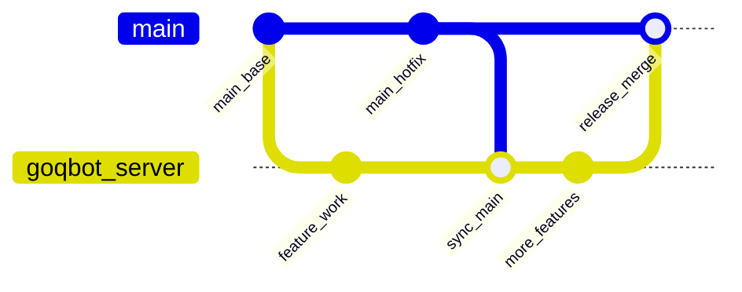

# 开发流程与 Git 使用说明

本文说明本仓库的分支模型、日常 Git 操作，以及大版本平行开发时的流程要求。

追踪大版本开发的 Draft PR：[#1](https://github.com/huilongxiji/gd-goqbot-framework/pull/1)

---

## 分支角色

| 分支 | 用途 |
|---|---|
| `main` | 稳定主线：已发布 / 可日常维护的源码 |
| `goqbot-server` | 大版本开发线：新功能在此迭代，与 `main` 平行推进 |

目标历史形态：从 `main` 拉出 `goqbot-server` → 两侧各自提交 → 定期把 `main` 合入开发分支 → 测试通过后以 **merge commit** 合回 `main`，并**保留** `goqbot-server` 分支（图上呈现首尾都连回 `main`）。



---

## 首次获取代码

克隆时保留仓库目录名，不要把文件直接摊到上级空目录：

```bash
git clone git@github.com:huilongxiji/gd-goqbot-framework.git
cd gd-goqbot-framework
```

大版本开发请切到 `goqbot-server`：

```bash
git fetch origin
git checkout goqbot-server
git pull origin goqbot-server
```

仅维护当前稳定线时使用 `main`：

```bash
git checkout main
git pull origin main
```

---

## 日常开发（在 goqbot-server）

1. 确认当前分支为 `goqbot-server`。
2. 本地修改、自测后提交并推送：

```bash
git status
git add <相关文件>
git commit -m "简明说明改动原因"
git push origin goqbot-server
```

3. 推送后，Draft PR [#1](https://github.com/huilongxiji/gd-goqbot-framework/pull/1) 会自动更新，无需每次新建 PR。

### 提交说明建议

- 用一两句话写清**为什么改**，而不是只罗列改了哪些文件。
- 不要把密钥、`config.yml`（含真实凭证）、本地数据目录等提交进仓库（见根目录 `.gitignore`）。

---

## 与 main 平行同步

`main` 在大版本开发期间仍会继续更新。开发分支必须定期吸收 `main` 的变更，避免最终合入时冲突过大。

在 `goqbot-server` 上执行：

```bash
git fetch origin
git merge origin/main
# 若有冲突：解决后 git add ... && git commit
git push origin goqbot-server
```

### 硬性要求

- **用 `merge` 同步，不要用 `rebase` 重写已推送历史**，以便保留「平行线」式提交图。
- 不要把未测试完的大版本改动直接推到 `main`。

---

## Draft PR 约定

| 项 | 要求 |
|---|---|
| 方向 | `goqbot-server` → `main` |
| 开发期间状态 | 保持 **Draft** |
| 合入前 | 功能完整，且全部迭代测试通过 |
| 合入方式 | **Create a merge commit**（禁止 Squash / Rebase merge） |
| 合入后 | **保留** `goqbot-server` 分支，不要删除 |

### 合入步骤（测试通过后）

1. 将 Draft PR 标记为 **Ready for review**。
2. 合并时选择 **Create a merge commit**。
3. 取消勾选 / 不要删除 `goqbot-server` 分支。

---

## 常用命令速查

```bash
# 查看状态与分支
git status
git branch -vv

# 拉取远程最新引用
git fetch origin

# 开发分支同步 main
git checkout goqbot-server
git merge origin/main

# 查看与 main 的差异
git log --oneline origin/main..goqbot-server
git diff origin/main...goqbot-server
```

---

## 流程检查清单

### 开发中

- [ ] 工作在 `goqbot-server`，不直接改 `main` 上的大版本功能
- [ ] 定期 `git merge origin/main` 同步主线
- [ ] 提交已推送到 `origin/goqbot-server`
- [ ] Draft PR 保持打开，正文约定未被改坏

### 准备合入 main

- [ ] 大版本功能开发完成
- [ ] 全部迭代测试通过
- [ ] 已同步最新 `main`，冲突已解决
- [ ] PR 改为 Ready for review
- [ ] 使用 **Create a merge commit** 合入
- [ ] 合入后仍保留 `goqbot-server` 分支

---

## 相关文档

- 移动监控（SSH / 中继 / Flutter）：[`monitor.md`](monitor.md)
