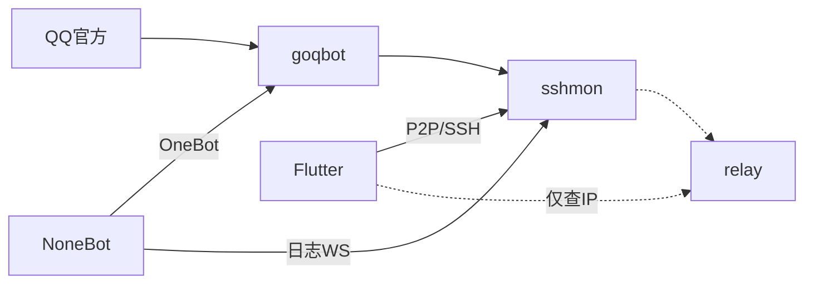

# 移动监控（sshmon + Flutter + 中继）

Telegram 风格安卓客户端通过 **SSH** 监控远程 goqbot 实例：按群查看聊天气泡与灰字服务消息（日志），并可发送群消息（被动优先，过期后主动 + 频控）。

## 组件

| 组件 | 路径 | 作用 |
|---|---|---|
| 官机内嵌 SSH | `internal/sshmon` | 事件推送、发消息、扫码配对、频控、订阅 NoneBot 日志 WS、UDP 打洞口 |
| 中继 | `relay/` | 仅存 `peer_id → ip:port`，供打洞失败后查地址 |
| NoneBot 日志桥 | `examples/nonebot_log_ws/` | 把 NoneBot logging 推到 WS，按群 `group_id` 路由 |
| App | `mobile/` | Flutter 安卓端 |



## 配置（config.yml）

```yaml
sshmon:
  enabled: true
  listen: "0.0.0.0:2222"
  data_dir: "sshmon"
  relay_url: "http://YOUR_RELAY:8787"
  pairing_ttl_sec: 300
  nonebot_log_ws: "ws://127.0.0.1:8081/log"
  p2p_listen: "0.0.0.0:2222"
  active_global_pm: 60
  active_group_pm: 20
```

启动官机后终端会打印 **ASCII 二维码 + JSON**（含 `server_id`、host key fingerprint、LAN、`pairing_token`）。用 App 扫码绑定。

## 中继自建

```bash
go run ./relay -listen 0.0.0.0:8787
# 或
go build -o goqbot-relay ./relay
```

- `PUT /peers/{id}` body: `{"ip":"","port":2222}`（ip 空则用连接方地址）
- `GET /peers/{id}` → `{"ip","port","updated_at"}`
- **不存**密钥、消息、token

## NoneBot 日志桥

见 [`examples/nonebot_log_ws/`](../examples/nonebot_log_ws/)。插件将日志 JSON 推到 `ws://HOST:PORT/log`，处理群消息时带上 `group_id`，App 在对应群聊时间线以 **居中灰字服务消息** 展示（按 level 着色）。

## App UI 约定

- **chat**：Telegram 式左右气泡（用户 / 官机）
- **log**：无气泡居中灰字（掉线提示、NoneBot 日志等）
- 无 `group_id` 的日志进入「实例日志」会话

## 连接顺序

1. 扫码里的局域网地址直连 SSH  
2. 失败 → `GET` 中继查官机当前 IP → UDP punch → 再连 SSH  
3. 中继不做消息转发；鉴权全在本地 SSH 密钥  

## 发送策略

- 5 分钟内有被动凭证：走 `send_group_msg`（被动）
- 否则主动：`send_group_active_msg`，并受 60/分钟全局、20/分钟单群限制

## 安全

- 中继无敏感数据  
- 扫码只含短期 `pairing_token` 与指纹，不含私钥  
- 配对成功后公钥写入官机 `sshmon/authorized_keys`，之后仅公钥登录  
