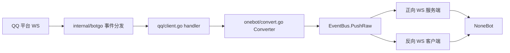
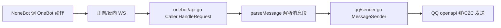
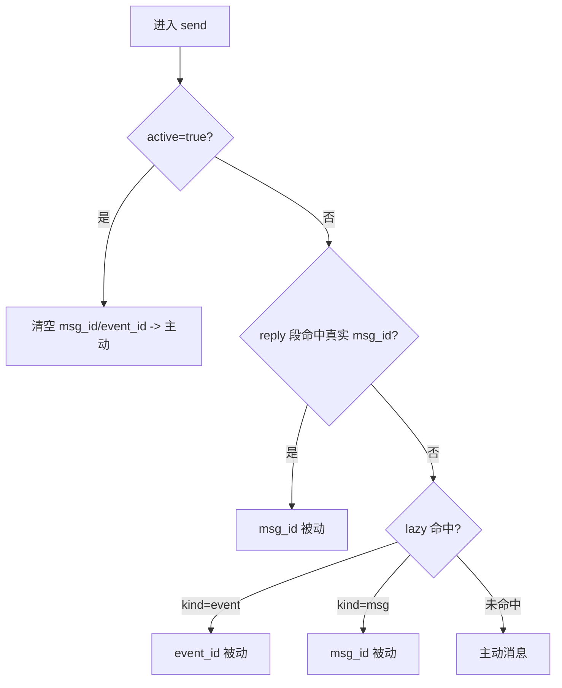
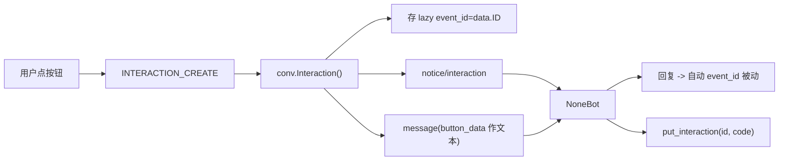

# goqbot 项目文档

基于 OneBot V11 的 QQ 官方机器人适配器（参考 go-cqhttp 思路），将 QQ 官方机器人（QQ 群 / 单聊 C2C）的事件与消息桥接为 OneBot V11 协议，供 NoneBot 等下游框架接入。

## 目录

1. [项目概述](#1-项目概述)
2. [目录结构与模块职责](#2-目录结构与模块职责)
3. [启动与整体数据流](#3-启动与整体数据流)
4. [配置说明（逐字段）](#4-配置说明逐字段)
5. [与 NoneBot 的连接层](#5-与-nonebot-的连接层)
6. [支持的 OneBot 动作（API）](#6-支持的-onebot-动作api)
7. [被动/主动消息与 ID 映射](#7-被动主动消息与-id-映射)
8. [入站事件支持矩阵](#8-入站事件支持矩阵)
9. [互动/按钮回调专题](#9-互动按钮回调专题)
10. [待实现 / 已知缺口](#10-待实现--已知缺口)
11. [NoneBot 使用示例](#11-nonebot-使用示例)
12. [构建与部署](#12-构建与部署)
13. [内化 botgo 与定制点](#13-内化-botgo-与定制点)
14. [日志系统](#14-日志系统)

---

## 1. 项目概述

- **定位**：QQ 官方机器人 ↔ OneBot V11 适配器。上游用 `internal/botgo`（QQ 官方 Go SDK 的内化 fork）通过 WebSocket 连 QQ；下游以 OneBot V11 正向/反向 WebSocket 对接 NoneBot。
- **运行形态**：独立进程，YAML 配置。既可作为正向 WS 服务端等 NoneBot 连入，也可作为反向 WS 客户端主动连 NoneBot 的 OneBot V11 适配器。
- **自包含**：botgo 已内化进 [internal/botgo](../internal/botgo/botgo.go)，`go.mod` 无 `replace`、无外部 botgo 依赖。Go 静态编译为**单个二进制**；运行时只需 `goqbot` 二进制 + `config.yml`（+ 自动生成的 `idmap.db`）。
- **当前范围**：QQ 群（GroupAT）与单聊（C2C）双向；频道（guild）线尚未接入（见第 10 章）。
- **富媒体收发**：群/单聊均支持图片、视频、语音、文件的发送与接收；本地大文件自动走分片上传（见第 7 章）。
- **私聊流式**：单聊(C2C)支持流式消息（打字机效果），通过 `stream` 消息段分帧下发（见第 6 章）。
- **日志分级**：统一 `[Info]/[Warning]/[Error]` 级别与格式，终端按级别上色、文件纯文本（见第 14 章）。

---

## 2. 目录结构与模块职责

| 路径 | 职责 |
|---|---|
| [main.go](../main.go) | 入口：加载配置、装配各组件、拉起 OneBot 与 QQ 两侧连接、信号退出 |
| [internal/config](../internal/config/config.go) | YAML 配置结构、默认值、self_id 推导、校验 |
| [internal/qq/client.go](../internal/qq/client.go) | QQ 上游客户端：鉴权、注册 handler、单分片连接与重连 |
| [internal/qq/sender.go](../internal/qq/sender.go) | `MessageSender` 实现：调 QQ openapi 发群/单聊消息、撤回、互动回执 |
| [internal/onebot/api.go](../internal/onebot/api.go) | `Caller`：OneBot 动作分发、消息段解析 |
| [internal/onebot/convert.go](../internal/onebot/convert.go) | `Converter`：QQ 事件 → OneBot V11 事件，推入 EventBus |
| [internal/onebot/server.go](../internal/onebot/server.go) | 正向 WS 服务端 |
| [internal/onebot/client.go](../internal/onebot/client.go) | 反向 WS 客户端 |
| [internal/onebot/event.go](../internal/onebot/event.go) | EventBus、lifecycle / heartbeat 元事件 |
| [internal/onebot/sender.go](../internal/onebot/sender.go) | `MessageSender` 接口与 `OutMessage`/`MessagePart` 抽象 |
| [internal/idmap/idmap.go](../internal/idmap/idmap.go) | openid↔int 映射、message_id、被动凭证 lazy 池、bbolt 持久化 |
| [internal/stats/stats.go](../internal/stats/stats.go) | 收发消息轻量统计，供心跳 status 填充 |
| [internal/botgo](../internal/botgo/botgo.go) | 内化的 QQ 官方 SDK（含本项目定制） |

---

## 3. 启动与整体数据流

### 启动顺序（[main.go](../main.go)）

1. 解析 `-config`（缺省取可执行文件同级 `config.yml`）。
2. `config.Load` → `Validate`。
3. idmap：`IDMap.Disabled` 为真用 `idmap.New()`（纯内存），否则 `idmap.Open(path)`（bbolt 持久化，相对路径=可执行文件同级），`defer Close`。
4. 装配 `EventBus` → `Caller` → `Converter`。
5. 遍历 `onebot.servers`：正向 `ws` 起 `WSServer.Run()`；反向 `ws-reverse` 起 `WSClient`（`StartHeartbeat` + `Run`）。
6. `qq.NewClient(...).Start(ctx)` 拉起 QQ 连接。
7. 等待 SIGINT/SIGTERM，`cancel()` 退出。

### 入站数据流（QQ → NoneBot）



### 出站数据流（NoneBot → QQ）



---

## 4. 配置说明（逐字段）

依据 [config.go](../internal/config/config.go) 与 [config.example.yml](../config.example.yml)。

### `qq.*`

| 字段 | 含义 |
|---|---|
| `app_id` | QQ 机器人 AppID |
| `uin` | 机器人 QQ 号；`use_uin=true` 时作 self_id |
| `use_uin` | true=self_id 用 uin；false=用 app_id |
| `token` | 机器人令牌（鉴权回退用） |
| `client_secret` | botgo AppSecret（鉴权优先用，回退 token）|
| `sandbox` | 是否走沙盒环境 openapi |
| `intents` | 可选，硬覆盖自动推导的 intent |
| `shard_count` | 分片总数，默认 1 |
| `shard_id` | 本进程分片号，从 0 起 |
| `text_intent` | 按 handler 名订阅事件，intent 自动推导 |
| `add_at_group` | 群消息上报是否在首段补 at self |
| `self_id` | 可选，覆盖上报 self_id |
| `disabled` | true 时跳过 QQ 连接（仅测 OneBot 侧） |

**self_id 推导**：显式 `self_id`>0 优先；否则 `use_uin && uin!=0` 用 `uin`；否则解析 `app_id` 为整数。`shard_count==0` 归一为 1。

### `onebot.*`

| 字段 | 含义 |
|---|---|
| `access_token` | 下游鉴权 token，空=不校验 |
| `heartbeat_interval` | 心跳间隔（毫秒），默认 5000，<=0 关闭心跳 |
| `message_format` | `array`(默认，消息段数组) 或 `string`(CQ 字符串) |
| `debug` | true 时打印收到的 action 请求日志 |
| `downtime_message` | 全下游掉线兜底回发 QQ 的文本，空=关闭 |
| `servers[].ws` | 正向 WS 服务端：`address`、`disabled` |
| `servers[].ws-reverse` | 反向 WS 客户端：`universal`/`api`/`event`、`reconnect-interval`(默认 3000ms)、`disabled` |

校验：同一 server 的 `ws` 与 `ws-reverse` 不能同时启用；正向需 `address`；反向需 `universal`/`api`/`event` 之一。

### `idmap.*`

| 字段 | 含义 |
|---|---|
| `disabled` | true=纯内存不持久化（重启后 message_id/反查丢失） |
| `path` | 持久化文件，默认 `idmap.db`；相对路径=可执行文件同级；不存在则创建 |

### `log.*`

| 字段 | 含义 |
|---|---|
| `enabled` | 是否写本地日志文件；缺省/`true`=落盘，`false`=仅终端（默认 true） |
| `path` | 日志目录，默认 `logs`；相对路径=可执行文件同级 |

日志分级与颜色策略见第 14 章。

---

## 5. 与 NoneBot 的连接层

### 正向 WS 服务端（[server.go](../internal/onebot/server.go)）

- 路由：`/event`（仅事件下行 + 握手 lifecycle）、`/api`（仅动作上行）、`/`（universal，事件+动作合一）。
- 鉴权 `checkAuth`：读 `Authorization: Token xxx` 或 query `access_token`；`access_token` 空则放行。
- 连接建立后下发 `lifecycle/connect` 元事件。
- 每条连接由专用 writer goroutine 串行写（`wsConn`，写队列 256，15s 写超时），写失败即关闭并从事件连接列表剔除。
- `heartbeatLoop` 按 `heartbeat_interval` 周期向所有事件连接推 heartbeat。

### 反向 WS 客户端（[client.go](../internal/onebot/client.go)）

- 支持 `universal` 或 `api`+`event` 两种拓扑；带 `X-Client-Role`/`X-Self-ID`/`Authorization` 头。
- 断线按 `reconnect-interval` 自动重连。
- **失败缓存重发**：事件写失败缓存进 `sendFailures`，新连接建立后 `flushFailures` 重投。
- `StartHeartbeat` 周期推心跳。

### 事件总线与心跳（[event.go](../internal/onebot/event.go) / [stats.go](../internal/stats/stats.go)）

- `EventBus.PushRaw` 向所有注册下游广播，**返回成功投递的连接数**——这是「全下游掉线兜底」的判定依据（投递数为 0 且配了 `downtime_message` 时直接回发 QQ）。
- 心跳 `status.stat` 填充 `message_received`/`message_sent`/`last_message_time`（来自 stats 原子计数）。`interval` 字段为 NoneBot 必填（毫秒）。

---

## 6. 支持的 OneBot 动作（API）

依据 [api.go](../internal/onebot/api.go) 的 `Call` 分发。请求经 `HandleRequest` 解析（`action` 去除 `_async` 后缀，回填 `echo`）。

| action | 参数 | 说明 |
|---|---|---|
| `get_login_info` | - | 返回 `user_id`(self_id)、`nickname`(app_id) |
| `get_status` | - | `{online:true, good:true}` |
| `get_version_info` | - | app 名/版本/协议版本 |
| `send_group_msg` | `group_id`,`message`,(`user_id`) | 发群消息（被动优先，见第 7 章） |
| `send_private_msg` | `user_id`,`message`,(`is_wakeup`) | 发单聊消息（被动优先）；`is_wakeup=true` 走互动召回；带 `stream` 段则流式发送并额外返回 `stream_id` |
| `send_msg` | `message_type`/自动判定+对应 id+`message` | 按类型分派到群/私聊 |
| `send_group_active_msg` | `group_id`,`message` | **强制主动**发群（忽略 reply/lazy） |
| `send_private_active_msg` | `user_id`,`message` | **强制主动**发单聊 |
| `put_interaction` / `send_interaction_ack` | `interaction_id`,`code`(默认0) | 互动按钮回执 |
| `delete_msg` | `message_id` | 撤回（按 message_id 查 QQ 原始 msg_id 撤回） |
| `get_msg` | `message_id` | 取回该 message_id 对应的消息元信息 |
| `get_forward_msg` | `id`/`message_id` | 取回合并转发的节点数组（由入站合并转发解析后缓存，FIFO 有界） |
| `get_openid` | `user_id`/`group_id` | 反查数字 id 对应的 QQ openid |

未识别的 action 返回空 `ok`。

### 消息段解析（`parseMessage`）

- 入参支持 **array 段数组** 与 **CQ 字符串** 两种。
- 支持段：`text`、`at`（转 `<@openid>`，at self/all 跳过）、`image`、`video`、`record`/`voice`/`audio`（语音）、`file`、`markdown`、`stream`（流式，仅 C2C）、`reply`（取被引用消息的 QQ msg_id 作被动凭证 + REFIDX 引用索引）。
- 输出为有序的 `OutMessage.Parts`（`PartText`/`PartImage`/`PartVideo`/`PartRecord`/`PartFile`/`PartMarkdown`），**每个非文本段单独成一条 QQ 消息按序发出**（文本/at 连续合并）。
- `markdown` 段（`parseMarkdownSeg`）：支持模板 markdown(custom_template_id+params) 与原生 markdown(content)，keyboard 来源 `data.keyboard` 优先于顶层 `rows`，兼容 `base64://`。
- 富媒体来源：`base64://`、`http(s)://`、`file://`/绝对路径（本地读取后 base64 直传或分片上传）。`file` 段可带 `name`（含扩展名），视频分片上传会自动补 `.mp4` 以便客户端识别为可播放视频。

### 流式消息（C2C，`parseMessage` 的 `stream` 段）

- `stream` 段携带 `{state, id, index, reset}`；`state`：1 正文生成中 / 10 正文结束 / 11 引导生成中 / 20 引导结束。
- **首帧**：`index=0` 且不带 `id`（平台据此新建流式会话）；发送成功后响应里额外返回 `stream_id`（即 QQ 侧消息 id）。
- **续帧**：把首帧的 `stream_id` 回填到 `id`，`index` 逐帧递增；**末帧** `state=10`。
- 注意：`index>=1` 但缺 `id` 会被平台判定为无效续帧（报 `stream.id无效`）；流式仅 C2C 生效，群聊会忽略 `stream` 并告警。
- 状态（id/index）由下游插件维护，框架每次调用无状态，只负责回传 `stream_id`。

---

## 7. 被动/主动消息与 ID 映射

### 被动凭证两类

QQ 发消息接口区分主动/被动：填 `msg_id`（回复消息）或 `event_id`（回复事件，如互动）即被动（免费、窗口内）；都不填即主动（生产受频率限制，沙盒不限）。

- lazy 池（[idmap.go](../internal/idmap/idmap.go)）按 `kind` 区分：收到普通消息存 `kind=msg`，收到互动事件存 `kind=event`。
- `LazyGroup`/`LazyC2C` 返回 `(id, kind, ok)`，群优先 group+user 维度。TTL：群 5 分钟、单聊 60 分钟。

### 发送时凭证选择优先级（[api.go](../internal/onebot/api.go) `sendGroup`/`sendPrivate`）



发送侧 [sender.go](../internal/qq/sender.go) 6 个 helper（群/单聊各 text/media/markdown）同时透传 `MsgID`/`EventID`；`msg_seq` 以实际凭证为键去重（`event_id` 优先），主动消息不带 `msg_seq`。

### ID 映射与持久化

- `openid → int64`：FNV64a 正整数哈希（确定性，重启稳定）；仅持久化**反向** `int64→openid`（bbolt `ids` 桶）。
- `message_id = hash(QQ msg_id)`（int64，非自增；同一 QQ 消息恒得同一 id）；`MsgMeta`（含 QQ 原始 `msg_id`/scene/openid/time）持久化到 bbolt `msgmeta` 桶。
- 内存 `sync.Map` 作缓存，未命中回落 bbolt。`lazy`/`msg_seq` 仍内存（短期态）。
- **QQ 原始 `ROBOT1.0_...` msg_id** 存于 `MsgMeta.MsgID`，用途：被动回复定位、`delete_msg` 撤回。

### 富媒体收发（图片/视频/语音/文件）

发送侧（[sender.go](../internal/qq/sender.go)）统一走 QQ 托管，无需自建图床/CDN：先上传得 `FileInfo`，再以 `MsgType=7` 富媒体消息携带 `media.file_info` 发出。`file_type`：1 图片 / 2 视频 / 3 语音 / 4 文件。

- **简单上传**（URL 或小体积 base64）：[message_create.go](../internal/botgo/dto/message_create.go) 的 `RichMediaMessage`（`Url`/`FileData` + `FileType` + 可选 `FileName`）一次性 POST 到 `/files` 换 `file_info`。
- **分片上传**（本地大文件，阈值 10MB）：`upload_prepare` 拿 `upload_id` 与预签名分片 → 并发 PUT 分片到腾讯 OSS 预签名地址 → `upload_part_finish` 逐片确认 → `files(upload_id)` 换 `file_info`（DTO 见 [rich_media_upload.go](../internal/botgo/dto/rich_media_upload.go)，含兼容字符串/数字的 `FlexInt64`）。
- **超时**：openapi 客户端默认 60s；发送动作的 context 超时按媒体体积动态放大（`sendTimeout`），避免大文件被 30s 提前取消。
- 群聊 `file_type=4`（文件）与单聊均已支持；单聊/群聊文件上传接口不互通，`file_info` 有 `ttl`。

接收侧（[convert.go](../internal/onebot/convert.go) `buildSegments`）按附件 `content_type` 归类为 OneBot 段：`image/*`→`image`、`video/*`→`video`、语音→`record`、其余 `application/*`→`file`（带 `name`/`file_size`），避免文档类附件被误标成图片。

---

## 8. 入站事件支持矩阵

### 已实现（转 OneBot 并上报）

依据 [client.go](../internal/qq/client.go) 注册 + [convert.go](../internal/onebot/convert.go) 转换。

| QQ 事件 | OneBot 上报 | handler 名 | 所属 intent |
|---|---|---|---|
| GROUP_AT_MESSAGE_CREATE | message/group | GroupATMessageEventHandler | IntentGroupMessages(1<<25) |
| C2C_MESSAGE_CREATE | message/private | C2CMessageEventHandler | 同上 |
| GROUP_ADD_ROBOT | notice/group_increase | GroupAddRobotEventHandler | 同上 |
| GROUP_DEL_ROBOT | notice/group_decrease | GroupDelRobotEventHandler | 同上 |
| GROUP_MSG_REJECT | notice/group_msg_reject（自定义） | GroupMsgRejectEventHandler | 同上 |
| GROUP_MSG_RECEIVE | notice/group_msg_receive（自定义） | GroupMsgReceiveEventHandler | 同上 |
| FRIEND_ADD | notice/friend_add | C2CFriendEventHandler | 同上 |
| FRIEND_DEL | notice/friend_decrease（自定义） | C2CFriendEventHandler | 同上 |
| C2C_MSG_REJECT | notice/c2c_msg_reject（自定义） | C2CMsgRejectEventHandler | 同上 |
| C2C_MSG_RECEIVE | notice/c2c_msg_receive（自定义） | C2CMsgReceiveEventHandler | 同上 |
| INTERACTION_CREATE | notice/interaction + message | InteractionHandler | IntentInteraction(1<<26) |
| 连接成功 | meta_event/lifecycle、heartbeat | ReadyHandler/内部 | — |
| WS 错误 | 仅日志 | ErrorNotifyHandler | — |

### 订阅原理

QQ 没给这批群/C2C 事件独立 intent 位，全部挂在 `IntentGroupMessages=1<<25` 下（[websocket_event.go](../internal/botgo/dto/websocket_event.go) 的 `intentEventMap`）。真正订阅的 intent 由**注册了哪些 handler 动态 OR 出来**（[register.go](../internal/botgo/event/register.go) `EventToIntent`），可被 `qq.intents` 硬覆盖。

`text_intent` 是配置里要启用的 handler 名清单；缺省只开 Ready/ErrorNotify/GroupAT/C2C，其余按需取消注释。

---

## 9. 互动/按钮回调专题

### 发带按钮消息（已实现）

NoneBot 用 markdown 消息段携带 keyboard → `parseMarkdownSeg` 解析 → `sendGroupMarkdown`/`sendC2CMarkdown` 以 `MsgType=2`（markdown+keyboard）发出。回调要触发需按钮 `action.type=1`（callback）并设 `button_data`。

### 点击回调闭环



- `Interaction()`（[convert.go](../internal/onebot/convert.go)）解析 `resolved` 取 `button_id`/`button_data`，存 lazy event 凭证，推 notice（带 `interaction_id`/`chat_type`/`data_type`/`button_*`）与 message（`button_data` 作文本，`message_id` 为互动 id 的 FNV 哈希，附 `interaction_id`）。
- ACK：NoneBot 自行决定 `code`（0=成功），调 `put_interaction` → `sender.AckInteraction` → `PutInteraction {"code":N}`（通用端点 `/interactions/{id}`，群/私聊通用）。不回执则用户端按钮显示失败提示。

### keyboard Action 支持字段

[keyboard.go](../internal/botgo/dto/keyboard/keyboard.go) 的 `Action` 含 `type/permission/click_limit/data/enter/at_bot_show_channel_list/subscribe_data/modal`，并已补：
- `reply`（指令按钮带引用回复）
- `anchor`（=1 唤起手机端相册选图器）
- `unsupport_tips`（客户端不支持该 action 时的 toast 文案）

---

## 10. 待实现 / 已知缺口

### 频道（guild）整条线未接（与 Gensokyo 的唯一差距）

QQ 群 / 单聊维度已与 Gensokyo 持平；缺口集中在频道：

| QQ 事件 | 现状 |
|---|---|
| AT_MESSAGE_CREATE（频道@） | 仅日志，未转换 |
| DIRECT_MESSAGE_CREATE（频道私信） | 仅日志，未转换 |
| MESSAGE_CREATE（频道非@/私域） | 未接 |
| GUILD_CREATE/UPDATE/DELETE | 未接 |
| CHANNEL_CREATE/UPDATE/DELETE | 未接 |
| GUILD_MEMBER_ADD/UPDATE/REMOVE | 未接 |
| FORUM_THREAD_*（论坛发帖） | 未接 |

底层 `internal/botgo` 已保留这些 handler 类型，补齐只需在 client.go 注册 + convert.go 写映射，不动 SDK。

### 双方都未实现
AUDIO_*（音频）、MESSAGE_REACTION_*（表态）、MESSAGE_AUDIT_*（审核）。

### 预留但未启用
`ENTER_AIO`/`IntentEnterAIO`、`SUBSCRIBE_MESSAGE_STATUS`（已在 intentEventMap 中但无 handler，不影响订阅）。

---

## 11. NoneBot 使用示例

```python
# 主动推送（不依赖触发消息；沙盒无限，生产受频率限制）
await bot.call_api("send_group_active_msg", group_id=123456, message="公告：今晚维护")
await bot.call_api("send_private_active_msg", user_id=123456, message="提醒：任务完成")

# 普通被动回复（自动用 msg_id/event_id）
await matcher.send("收到")
await bot.send(event, "收到")

# 互动按钮回执（NoneBot 决定 code）
@on_notice()
async def _(bot, event):
    if getattr(event, "notice_type", "") == "interaction":
        await bot.call_api("put_interaction", interaction_id=event.interaction_id, code=0)

# 入退群 / 推送开关 / 好友
@on_notice()
async def _(bot, event):
    nt = getattr(event, "notice_type", "")
    # group_increase / group_decrease / friend_add / friend_decrease
    # group_msg_reject / group_msg_receive / c2c_msg_reject / c2c_msg_receive
    ...
```

markdown + keyboard 发送沿用消息段方式（见 `src/markdown_segment.py` 构建格式），按 NoneBot send 顺序逐条发出。

```python
# 富媒体：本地文件转 base64 后用对应段发送（示例见 src/plugins/media_upload_demo.py）
seg = MessageSegment("record", {"file": "base64://...", "name": "demo.mp3"})  # 语音；video/file 同理
await matcher.send(seg)

# 私聊流式（示例见 src/plugins/c2c_stream_demo.py）：首帧 index=0 无 id，取回 stream_id 串后续帧
r = await bot.send_private_msg(user_id=uid,
        message=MessageSegment("stream", {"state": 1, "index": 0}) + MessageSegment.text("这是"))
sid = r["stream_id"]
await bot.send_private_msg(user_id=uid,
        message=MessageSegment("stream", {"state": 1, "id": sid, "index": 1}) + MessageSegment.text("续帧"))
await bot.send_private_msg(user_id=uid,
        message=MessageSegment("stream", {"state": 10, "id": sid, "index": 2}) + MessageSegment.text("收尾\n"))

# 唤起相册：keyboard 指令按钮 action.type=2 + anchor=1（示例见 src/plugins/c2c_stream_demo.py 的 /唤起相册）
```

---

## 12. 构建与部署

```bash
cd goqbot
GOPROXY=https://goproxy.cn,direct go build -o goqbot .
```

- 产物：单个二进制 `goqbot`（约 12M）。
- 运行所需：二进制 + 同级 `config.yml`；`idmap.db` 首次运行自动在可执行文件同级创建（除非 `idmap.disabled=true`）。
- 换机器构建无需外部 botgo（已内化）。

### 多平台交叉编译（[dist/](../dist)）

`dist/` 下提供 6 个平台的预编译产物，可用如下方式一次性生成：

```bash
cd goqbot
for t in darwin/amd64 darwin/arm64 linux/amd64 linux/arm64 windows/amd64 windows/arm64; do
  os=${t%/*}; arch=${t#*/}; ext=""; [ "$os" = windows ] && ext=.exe
  GOOS=$os GOARCH=$arch go build -o dist/goqbot-$os-$arch$ext .
done
```

产物：`goqbot-darwin-amd64`、`goqbot-darwin-arm64`、`goqbot-linux-amd64`、`goqbot-linux-arm64`、`goqbot-windows-amd64.exe`、`goqbot-windows-arm64.exe`。

---

## 13. 内化 botgo 与定制点

- **为何内化**：原先 `go.mod` 用 `replace => ../botgo` 指向本地 fork，换机器/缺该目录就编译失败。现按 `go list -deps` 把实际用到的 17 个包搬进 [internal/botgo](../internal/botgo/botgo.go)，去掉 `replace`，项目自给自足。
- **保留范围**：dto（含 keyboard/message）、event、openapi（含 v1/options）、websocket（含 client）、sessions（local/manager）、token、log、errs、constant、version、根 botgo 包。**排除**了重依赖：`interaction/*`（uuid）、`sessions/remote`（redis），以及 examples/scripts/docs/测试。
- **相对官方 botgo 的定制**：
  - `dto.RichMediaMessage.FileData`：图片 base64 直传，无需图床。
  - `dto/group_manage.go` + `websocket_event.go`：新增 GROUP_ADD/DEL_ROBOT、GROUP_MSG_REJECT/RECEIVE、C2C_MSG_REJECT/RECEIVE 等事件并挂入 `IntentGroupMessages`；`event/` 补对应 handler 与解析。
  - `dto/keyboard` 的 `Action` 补 `reply`/`anchor`/`unsupport_tips`。
  - 互动回执 `PutInteraction` 走通用端点 `/interactions/{id}`。
  - `dto.MessageToCreate.Stream` + `dto.Stream`：私聊流式消息（`Index` 无 `omitempty`，保证首帧 `index=0` 下发）。
  - 富媒体分片上传：`openapi/v1` 新增 `upload_prepare`/`upload_part_finish`/`files(upload_id)` 端点与 `PutUploadPart`（预签名直传），DTO 见 `dto/rich_media_upload.go`。

---

## 14. 日志系统

三条输出路径最终都汇入 stderr + 同一份按天滚动的本地文件（[filelog](../internal/filelog/filelog.go)，`goqbot-YYYY-MM-DD.log`）：

| 来源 | 入口 | 格式 |
|---|---|---|
| app 代码（onebot/qq/main） | 标准库 `log.*`（Info）+ `filelog.Warnf/Errorf/Fatalf`（分级） | `[Level] 2006-01-02 15:04:05 msg` |
| 内化 botgo SDK | [botlog.go](../internal/qq/botlog.go) `botLogger` | `[Level] 2006-01-02 15:04:05 [botgo] msg` |
| 收/发/通知/错误块 | [prettylog](../internal/prettylog/prettylog.go) 边框块 | 带标题的框，标题内含时间 |

### 统一规则

- **级别语义**：真正的错误/警告用 `filelog.Errorf`/`Warnf`（如 WebSocket 错误、连接失败、上传失败、panic → `[Error]`；掉线重连、忽略项 → `[Warning]`），信息类仍走 `log.Printf` 显示 `[Info]`。`filelog.Fatalf` 输出 `[Error]` 后退出。
- **输出流统一**：app 标准 log、`filelog.*`、prettylog、botgo 全部写 **stderr**（不再有 stdout/stderr 混用）。
- **颜色策略**：`FormatLine` 只给级别标签上色——`[Error]` 红、`[Warning]` 黄，其余不上色；且**仅当 stderr 是终端**（`colorOn`）时才上色。
- **文件永远纯文本**：`WriteFile` 统一走 `StripANSI` 去色，日志文件不含任何 ANSI。
- **心跳过滤**：`debug=false` 时终端丢弃 botgo 逐拍心跳，文件始终写入（含心跳）。

日志目录由 `log.path` 配置（相对路径=可执行文件同级），`log.enabled` 控制是否落盘（缺省或 `true`=落盘，`false`=仅终端）。
